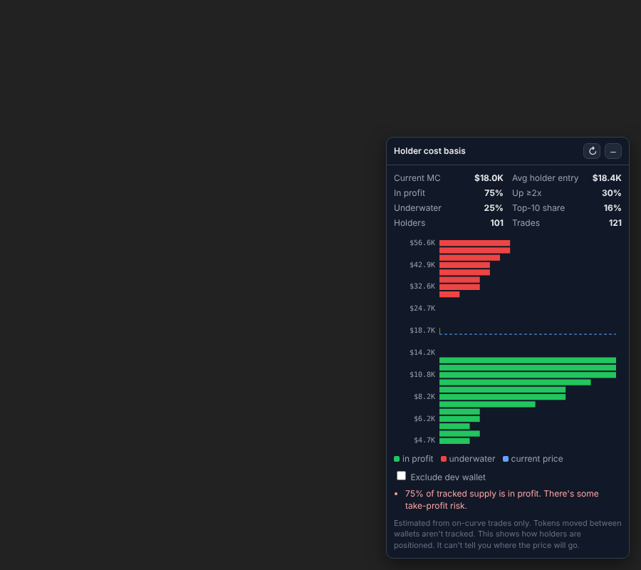

# Pump.fun Cost Basis Map (Chrome extension)

Adds a panel to every `pump.fun/coin/<mint>` page. The panel shows the price levels
where the **current holders** bought, so you can see how much supply is in profit
and how much is underwater.



## What it shows

- **Cost-basis histogram.** For each wallet still holding, the average entry price,
  grouped into price bands and labeled as market cap. Green bands are in profit,
  red bands are underwater, and the dashed blue line is the current price.
- **Stats.** Average holder entry, % of supply in profit, % up 2x or more,
  % underwater, top-10 wallet share, and holder and trade counts.
- **Readout.** Plain-language notes on the positioning, for example:
  - Lots of supply up 2x or more: take-profit sell pressure on pumps.
  - A large underwater cluster just above price: break-even sellers (resistance)
    if price returns there.
  - Most supply underwater: little reason for holders to sell at the current price.
- **Exclude dev wallet** toggle, which removes the creator's position from the stats.

The panel refreshes every 60s while the tab is visible. Click ↻ to refresh manually.

## How it works

`background.js` pages through `https://frontend-api-v3.pump.fun/trades/all/<mint>`
(200 trades per request, up to 10,000 by default) and reads coin info from
`/coins/<mint>`. `analysis.js` replays the trades per wallet using average-cost
accounting: buys add tokens and SOL cost, and sells remove tokens at the wallet's
average cost. Whatever each wallet still holds is plotted at its average entry price.

## Limitations

- It only sees trades that go through the pump.fun API. Tokens moved between wallets
  aren't tracked, and neither are trades on other DEXes after graduation.
- The pump.fun API is unofficial and can change or rate-limit. If the panel shows an
  HTTP error, the API URL may need updating in **Options**. A new host also has to be
  added to `host_permissions` in `manifest.json`.
- This describes how holders are positioned. It is not a price prediction.

## Install

1. Open `chrome://extensions` and turn on **Developer mode**.
2. Click **Load unpacked** and select this `pumpfun-cost-basis` folder.
3. Open any coin on pump.fun. The panel appears in the bottom-right corner.

It also works in Brave, Edge, and other Chromium browsers.

## Tests

```
node --test test/analysis.test.js
```
